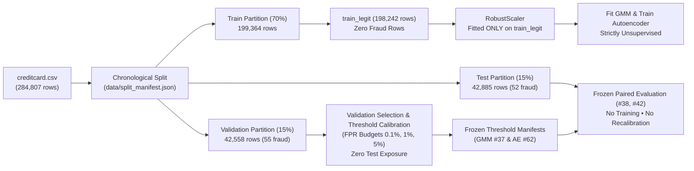
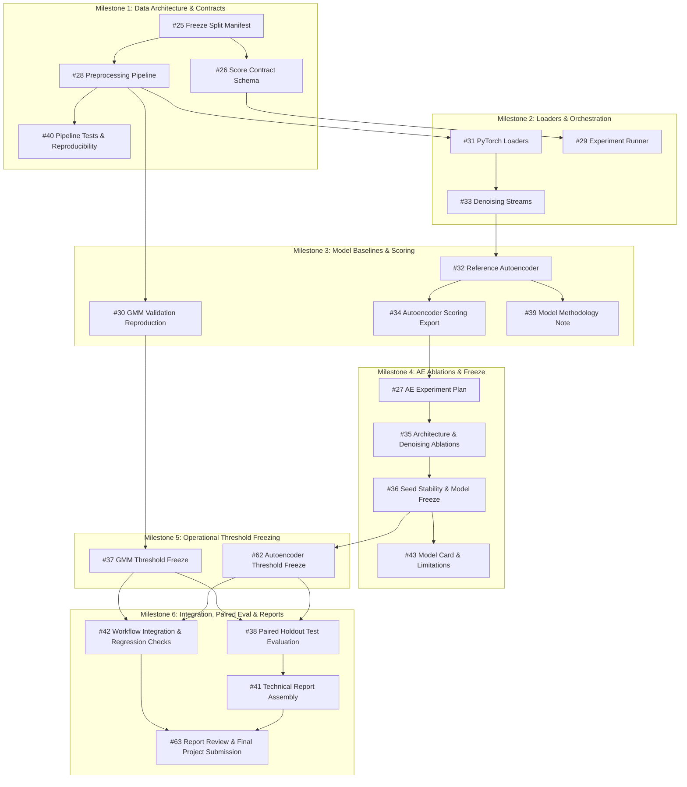
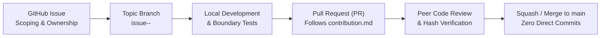

# Card Fraud Triage (Project 26)

> **Unsupervised Anomaly Detection & Density Scoring: Gaussian Mixture Models versus Undercomplete Denoising Autoencoders**  
> **Course:** Advanced Machine Learning & Deep Learning (AML + DL)  
> **Repository:** [Card-Fraud-Triage-ML-DL](https://github.com/WizardCarp85/Card-Fraud-Triage-ML-DL)

An unsupervised, leakage-free machine learning and deep learning benchmarking system for real-time credit card fraud triage. The system models legitimate transaction manifolds to prioritize suspicious events for fraud analyst review queues, comparing classical probabilistic density estimation (Gaussian Mixture Models) against deep non-linear reconstruction learning (Undercomplete Denoising Autoencoders) under realistic operational constraints.

---

## 1. Project Overview & Phase 2 Objectives

In high-throughput payment systems, fraud analysts can manually investigate only a small fraction of transactions. Rather than evaluating models on misleading raw accuracy, this project formulates fraud triage as an **unsupervised anomaly ranking problem** evaluated on operational trade-offs:
- **Precision-Recall Area Under the Curve (PR-AUC / Average Precision)**
- **Recall at strict False Positive Rate budgets** ($\text{FPR} \in \{0.1\%, 1\%, 5\%\}$)
- **Precision and fraud capture within daily review capacity limits** ($K \in \{100, 500, 1000\}$ alerts)

### GMM versus Autoencoder Comparative Benchmarking
- **Gaussian Mixture Model (GMM)**: Models the continuous probability density function $p(\mathbf{x})$ of legitimate transactions as a mixture of full-covariance Gaussians ($K=14$). Anomaly scores are computed as negative log-likelihood:
  $$\text{Score}_{\text{GMM}}(\mathbf{x}) = -\ln p(\mathbf{x})$$
- **Undercomplete Denoising Autoencoder (AE)**: Learns a non-linear low-dimensional manifold via bottleneck compression with corrupted inputs ($\sigma = 0.5$ Gaussian noise) and clean reconstruction targets ($29 \to 32 \to 16 \to 32 \to 29$ with BatchNorm and LeakyReLU). Anomaly scores are computed as Mean Squared Error (MSE) reconstruction loss:
  $$\text{Score}_{\text{AE}}(\mathbf{x}) = \frac{1}{D} \sum_{d=1}^D (x_d - \hat{x}_d)^2$$

> [!NOTE]
> **Score Fusion Status**: Hybrid GMM–Autoencoder score fusion and ensemble stacking are explicitly designated as **deferred / optional extensions** and are not part of the core deliverable. Both models are evaluated as independent, frozen contenders.

---

## 2. Team Members & Responsibility Distribution

### Phase 2 Responsibility Distribution

| Contributor | GitHub Handle | Phase 2 Core Ownership & Deliverables |
|:---|:---|:---|
| **Yashkumar Nimje** | [@WizardCarp85](https://github.com/WizardCarp85) | **Dataset Split & Provenance ([#25](https://github.com/WizardCarp85/Card-Fraud-Triage-ML-DL/issues/25)), Phase 2 Experiment Runner & Layout ([#29](https://github.com/WizardCarp85/Card-Fraud-Triage-ML-DL/issues/29)), Autoencoder Validation Threshold Calibration ([#62](https://github.com/WizardCarp85/Card-Fraud-Triage-ML-DL/issues/62)), End-to-End Workflow Integration & Regression Checks ([#42](https://github.com/WizardCarp85/Card-Fraud-Triage-ML-DL/issues/42)), and Project Maintainership ([#67](https://github.com/WizardCarp85/Card-Fraud-Triage-ML-DL/issues/67)).** |
| **Somraj Nandi** | [@somraj112](https://github.com/somraj112) | **Shared Score Contract & Schema ([#26](https://github.com/WizardCarp85/Card-Fraud-Triage-ML-DL/issues/26)), GMM Validation Threshold Freezing ([#37](https://github.com/WizardCarp85/Card-Fraud-Triage-ML-DL/issues/37)), Final Paired Test Evaluation ([#38](https://github.com/WizardCarp85/Card-Fraud-Triage-ML-DL/issues/38)), Technical Report Assembly ([#41](https://github.com/WizardCarp85/Card-Fraud-Triage-ML-DL/issues/41)), and Final Report Review ([#63](https://github.com/WizardCarp85/Card-Fraud-Triage-ML-DL/issues/63)).** |
| **Abhigya Sachdeva** | [@ABHIGYA0205](https://github.com/ABHIGYA0205) | **Autoencoder Experiment Plan ([#27](https://github.com/WizardCarp85/Card-Fraud-Triage-ML-DL/issues/27)), Stage-1 Architecture & Denoising Ablations ([#35](https://github.com/WizardCarp85/Card-Fraud-Triage-ML-DL/issues/35)), Multi-Seed Stability & Winning Checkpoint Freeze ([#36](https://github.com/WizardCarp85/Card-Fraud-Triage-ML-DL/issues/36)), Model Card and Limitations ([#43](https://github.com/WizardCarp85/Card-Fraud-Triage-ML-DL/issues/43)).** |
| **Saksham Narotra** | [@sakshaaamm](https://github.com/sakshaaamm) | **Shared 29-Feature Preprocessing Pipeline ([#28](https://github.com/WizardCarp85/Card-Fraud-Triage-ML-DL/issues/28)), PyTorch DataLoaders with Denoising Streams ([#31](https://github.com/WizardCarp85/Card-Fraud-Triage-ML-DL/issues/31), [#33](https://github.com/WizardCarp85/Card-Fraud-Triage-ML-DL/issues/33)), Data Pipeline Tests & Clean-Environment Reproducibility ([#40](https://github.com/WizardCarp85/Card-Fraud-Triage-ML-DL/issues/40)).** |
| **Rudra Pratap Singh Choudhary** | [@Rudra-choudhary](https://github.com/Rudra-choudhary) | **Phase 1 GMM Baseline Reproduction on Shared Split ([#30](https://github.com/WizardCarp85/Card-Fraud-Triage-ML-DL/issues/30)), Reference Autoencoder Baseline ([#32](https://github.com/WizardCarp85/Card-Fraud-Triage-ML-DL/issues/32)), Anomaly Scoring & Inference Pipeline ([#34](https://github.com/WizardCarp85/Card-Fraud-Triage-ML-DL/issues/34)), Model Methodology Writeup ([#39](https://github.com/WizardCarp85/Card-Fraud-Triage-ML-DL/issues/39)).** |

---

## 3. Data Governance & Leakage-Free Evaluation Protocol



### Protocol Guarantees
1. **Chronological Temporal Split**: Partitions preserve real-world causality: 70% Train (rows 0–199,363), 15% Validation (rows 199,364–241,921), 15% Test (rows 241,922–284,806). Exact boundary index mappings and SHA-256 digests are locked in [`data/split_manifest.json`](file:///Users/Wizard/Documents/Projects/Working/Card-Fraud-Triage-ML-DL/data/split_manifest.json).
2. **Legitimate-Only Training Rule**: Under the unsupervised anomaly detection paradigm, model training represents only normal transaction density. All historical fraud rows are excluded from `train_legit` (198,242 rows; 0 fraud). `RobustScaler` is fitted *strictly* on `train_legit`; labels (`Class`) are never seen by any model.
3. **Validation-Only Hyperparameter Tuning & Threshold Calibration**: Model selection (latent dimension, denoising variance, seed stability) and operational threshold calibration across FPR budgets (0.1%, 1%, 5%) are derived exclusively on validation scores and labels. No holdout test labels or scores enter calibration.
4. **Frozen Holdout Test Evaluation**: Test evaluation consumes pre-calibrated frozen thresholds and frozen weights. Training (`.fit()`) and threshold adjustment (`select_threshold_at_fpr()`) are programmatically forbidden during test evaluation.

---

## 4. Phase 2 Implementation Roadmap

The project was executed following dependency-ordered milestones:



### Dependency-Ordered Milestone Index
- **Milestone 1: Data Architecture & Contracts**
  - [#25 Reproduce and freeze split manifest](https://github.com/WizardCarp85/Card-Fraud-Triage-ML-DL/issues/25) — Deterministic temporal boundaries and SHA-256 manifest.
  - [#28 Rebuild 29-feature preprocessing pipeline](https://github.com/WizardCarp85/Card-Fraud-Triage-ML-DL/issues/28) — Continuous feature transformations and `RobustScaler` on `train_legit`.
  - [#40 Data-pipeline tests and clean-environment reproducibility](https://github.com/WizardCarp85/Card-Fraud-Triage-ML-DL/issues/40) — Independent reproducibility checks.
  - [#26 Shared evaluation and anomaly-score contract schema](https://github.com/WizardCarp85/Card-Fraud-Triage-ML-DL/issues/26) — Universal score interface and verification loader.
- **Milestone 2: Loaders & Orchestration**
  - [#31 Build PyTorch data loaders](https://github.com/WizardCarp85/Card-Fraud-Triage-ML-DL/issues/31) / [#33 Denoising input pipeline](https://github.com/WizardCarp85/Card-Fraud-Triage-ML-DL/issues/33) — 4 stream loader bundle with zero label exposure.
  - [#29 Phase 2 workflow orchestration runner](https://github.com/WizardCarp85/Card-Fraud-Triage-ML-DL/issues/29) — Reproducible execution runner and artifact isolation layout.
- **Milestone 3: Model Baselines & Scoring**
  - [#30 Reproduce GMM baseline on shared validation split](https://github.com/WizardCarp85/Card-Fraud-Triage-ML-DL/issues/30) — Validation baseline verification.
  - [#32 Reference autoencoder baseline](https://github.com/WizardCarp85/Card-Fraud-Triage-ML-DL/issues/32) / [#39 Model methodology note](https://github.com/WizardCarp85/Card-Fraud-Triage-ML-DL/issues/39) — Architecture formulation and mathematical writeup.
  - [#34 Validation scoring and inference export](https://github.com/WizardCarp85/Card-Fraud-Triage-ML-DL/issues/34) — Autoencoder scoring contract compliance.
- **Milestone 4: Autoencoder Experimentation & Selection**
  - [#27 Pre-register autoencoder experiment plan](https://github.com/WizardCarp85/Card-Fraud-Triage-ML-DL/issues/27) — Hypotheses and ablation protocols.
  - [#35 Stage-1 architecture and denoising ablations](https://github.com/WizardCarp85/Card-Fraud-Triage-ML-DL/issues/35) — Widths 4, 8, 16 and clean vs. denoising ($\sigma=0.5$).
  - [#36 Seed stability and winning model checkpoint freeze](https://github.com/WizardCarp85/Card-Fraud-Triage-ML-DL/issues/36) — Multi-seed confirmation; selected `RUN-S2-W16-DNZ-S7`.
  - [#43 Model card and limitations record](https://github.com/WizardCarp85/Card-Fraud-Triage-ML-DL/issues/43) — Auditable governance card.
- **Milestone 5: Validation Calibration & Freezing**
  - [#37 Calibrate and freeze GMM validation thresholds](https://github.com/WizardCarp85/Card-Fraud-Triage-ML-DL/issues/37) — GMM decision policies at budgets 0.1%, 1%, 5%.
  - [#62 Calibrate and freeze Autoencoder validation thresholds](https://github.com/WizardCarp85/Card-Fraud-Triage-ML-DL/issues/62) — Symmetrical AE decision policies.
- **Milestone 6: System Integration, Paired Evaluation & Project Reports**
  - [#42 Workflow integration and end-to-end regression checks](https://github.com/WizardCarp85/Card-Fraud-Triage-ML-DL/issues/42) — Stage boundary validation engine and frozen test path.
  - [#38 Run final paired GMM-versus-autoencoder test evaluation](https://github.com/WizardCarp85/Card-Fraud-Triage-ML-DL/issues/38) — Head-to-head test inference and queue overlap analysis.
  - [#41 Assemble Phase 2 technical report](https://github.com/WizardCarp85/Card-Fraud-Triage-ML-DL/issues/41) / [#63 Review and update final project submission](https://github.com/WizardCarp85/Card-Fraud-Triage-ML-DL/issues/63) — Two-column IEEE publication-style report and documentation.

---

## 5. Paired Holdout Test Evaluation Results

On the holdout test partition (42,560 evaluated transactions, 52 fraud cases), both models were scored using their frozen checkpoints and evaluated against pre-calibrated validation thresholds:

### Full Ranking Metrics
| Model | Test AP (PR-AUC) | Test ROC-AUC | Validation AP | Selection Status |
|:---|:---:|:---:|:---:|:---:|
| **Gaussian Mixture Model (GMM)** | **0.6773** | 0.9067 | 0.6970 | Phase 1 Baseline Benchmark |
| **Denoising Autoencoder (AE)** | 0.4867 | **0.9199** | 0.3245 | Frozen Candidate (`RUN-S2-W16-DNZ-S7`) |

### Operational Performance at Pre-Calibrated Validation Thresholds
| Model | Target FPR Budget | Frozen Threshold | Test Recall | Realized Test FPR | Test Precision | Frauds Caught | False Alarms | Missed Frauds |
|:---|:---:|:---:|:---:|:---:|:---:|:---:|:---:|:---:|
| **GMM** | **0.1%** | 143.6508 | **63.46%** | 0.0094% | **89.19%** | 33 / 52 | **4** | 19 |
| **AE** | **0.1%** | 4.1561 | 46.15% | 0.0329% | 63.16% | 24 / 52 | 14 | 28 |
| **GMM** | **1.0%** | 67.9595 | 73.08% | 0.1623% | **35.51%** | 38 / 52 | **69** | 14 |
| **AE** | **1.0%** | 0.8891 | **76.92%** | 0.4729% | 16.60% | 40 / 52 | 201 | 12 |
| **GMM** | **5.0%** | 39.1820 | 78.85% | 2.1502% | 4.29% | 41 / 52 | 914 | 11 |
| **AE** | **5.0%** | 0.4583 | 78.85% | 1.8044% | 5.07% | 41 / 52 | 767 | 11 |

### Analyst Review Queue Overlap ($K \in \{100, 500, 1000\}$)
| Review Capacity ($K$) | Caught by Both | Caught ONLY by GMM | Caught ONLY by AE | Union Caught | Queue Overlap |
|:---:|:---:|:---:|:---:|:---:|:---:|
| **$K = 100$** | 38 | 0 | **2** | **40 / 52** | GMM: 38 / AE: 40 |
| **$K = 500$** | 39 | 0 | **1** | **40 / 52** | GMM: 39 / AE: 40 |
| **$K = 1000$** | 41 | 0 | 0 | **41 / 52** | GMM: 41 / AE: 41 |

> [!TIP]
> **Key Finding**: GMM achieves a higher global PR-AUC (0.6773 vs 0.4867) and cleaner precision at the strictest 0.1% FPR budget (89.2% vs 63.2%). However, in the constrained top-100 review queue, the Autoencoder captures **2 unique frauds** missed by GMM (`row_id: 272521, 274475`), indicating complementary error profiles.

---

## 6. Contributor Workflow & Branching Guidelines

This project strictly adheres to the workflow specified in [`contribution.md`](file:///Users/Wizard/Documents/Projects/Working/Card-Fraud-Triage-ML-DL/contribution.md):



1. **Issue Scoping**: Every task maps to an explicit GitHub issue defining acceptance criteria and dependencies.
2. **Branch Isolation**: Work begins on a dedicated topic branch branched from up-to-date `origin/main`:
   ```bash
   git checkout -b issue-<issue_number>-<descriptive_title> origin/main
   ```
3. **Boundary Verification**: Changes must pass repository linters and unit tests:
   ```bash
   python3 -m ruff check
   python -m unittest discover tests
   ```
4. **Pull Request Protocol**: PRs require the template from [`contribution.md`](file:///Users/Wizard/Documents/Projects/Working/Card-Fraud-Triage-ML-DL/contribution.md) detailing related issues, changes made, verification commands, and boundary audit checks.
5. **No Direct Commits to Main**: All code must land on `main` via reviewed pull requests.

---

## 7. Setup & Reproducibility Guide

### Environment Setup
Requires Python 3.9–3.13. Create and activate a virtual environment:

```bash
python3 -m venv venv
source venv/bin/activate
pip install -r requirements.txt
```

### Dataset Access
Download the Kaggle Credit Card Fraud Detection dataset (`creditcard.csv`) and place it in `data/creditcard.csv`. Verify its integrity against the frozen manifest:

```bash
# Verify dataset SHA-256 and partition boundaries
python -m data.freeze_split --check
```

### Core Execution Commands

```bash
# 1. Run full Phase 2 end-to-end pipeline (GMM & Autoencoder)
python run_phase2.py all --model all

# 2. Run the frozen holdout test evaluation path
python run_phase2.py eval-frozen --output-dir results/phase2/frozen_eval

# 3. Verify deterministic calibration of validation thresholds
python -m scripts.freeze_gmm_thresholds --check
python -m scripts.freeze_ae_thresholds --check

# 4. Run the paired comparison evaluation
python -m scripts.evaluate_frozen_pair \
  --ae-scores data/scores/autoencoder_test.csv \
  --ae-thresholds results/phase2/autoencoder/threshold_manifest.json

# 5. Run complete repository test suite (98+ unit and integration tests)
python -m unittest discover tests
```

---

## 8. Repository Structure

```
Card-Fraud-Triage-ML-DL/
├── README.md                                  # Project overview and governance guide
├── contribution.md                            # Contributor PR template and rules
├── run_phase2.py                              # Master orchestration runner CLI shortcut
├── evaluation.py                              # Shared evaluation contract and metrics
├── data/
│   ├── creditcard.csv                         # Raw dataset (external, Kaggle)
│   ├── split_manifest.json                    # Frozen temporal split boundaries & hashes
│   ├── freeze_split.py                        # Split generator and check script
│   ├── preprocessing.py                       # 29-feature transformation and scaler pipeline
│   ├── artifacts/
│   │   ├── feature_metadata.json              # Scaler parameters and tolerances
│   │   └── scaler_robust_phase2.joblib        # Rebuilt Phase 2 RobustScaler
│   ├── scores/                                # Authoritative score and label exports
│   │   ├── gmm_validation.csv                 # GMM validation anomaly scores
│   │   ├── gmm_test.csv                       # GMM test anomaly scores
│   │   ├── autoencoder_test.csv               # Frozen Autoencoder test scores
│   │   ├── validation_labels.csv              # Isolated validation ground truth
│   │   └── test_labels.csv                    # Isolated test ground truth
│   └── splits/                                # Frozen split row ID index files
│       ├── train_indices.csv
│       ├── val_indices.csv
│       └── test_indices.csv
├── src/
│   ├── boundary_checks.py                     # Stage boundary isolation validators
│   ├── config.py                              # Strongly-typed configuration schema
│   ├── data.py                                # Partition ingestion engine
│   ├── evaluation_runner.py                   # Automated triage table generator
│   ├── loaders.py                             # PyTorch DataLoaders with denoising
│   ├── preprocessing.py                       # Preprocessing pipeline wrapper
│   ├── provenance.py                          # Environmental audit generator
│   ├── run.py                                 # Core execution pipeline
│   ├── threshold_calibration.py               # Shared validation threshold calibrator
│   └── models/
│       ├── base.py                            # BaseAnomalyModel interface
│       ├── gmm.py                             # GMM probabilistic scorer
│       └── autoencoder.py                     # Deep PyTorch Autoencoder net & scorer
├── results/
│   ├── ae_frozen_model_manifest.json          # Winning AE checkpoint governance manifest
│   ├── ae_seed_stability.md                   # Multi-seed stability report
│   ├── ae_ablations_stage1.md                 # Stage 1 ablation experiment report
│   └── phase2/
│       ├── ae_run_log.csv                     # RFC-compliant run-log of all AE runs
│       ├── checkpoints/                       # PyTorch model checkpoints (.pt)
│       ├── gmm/
│       │   └── threshold_manifest.json        # Frozen GMM validation thresholds
│       ├── autoencoder/
│       │   └── threshold_manifest.json        # Frozen AE validation thresholds
│       ├── frozen_eval/                       # Frozen test evaluation outputs
│       └── paired/                            # Paired comparison artifacts
│           ├── ranking.csv                    # Test AP and ROC-AUC metrics
│           ├── thresholds.csv                 # Operational metrics across FPR budgets
│           ├── triage.csv                     # Review queue capacity metrics
│           ├── overlap.csv                    # Fraud detection overlap analysis
│           ├── precision_recall.png           # Comparative Precision-Recall curves
│           └── interpretation.md              # Synthesis of paired benchmarking
├── docs/
│   ├── PHASE2_INTEGRATED_WORKFLOW.md          # Architectural guide & boundary checks
│   ├── PHASE2_WORKFLOW_ORCHESTRATION.md       # Runner documentation and config spec
│   ├── Phase2_Preprocessing.md                # 29-feature scaling specification
│   ├── Phase2_Data_Reproducibility.md         # Data pipeline reproducibility report
│   ├── ae_experiment_plan.md                  # Pre-registered AE experiment design
│   ├── model_card.md                          # Frozen AE model card and limitations
│   ├── paired_evaluation.md                   # Protocol for paired test comparison
│   └── threshold_manifest_schema.md           # Schema for threshold manifests
├── reports/
│   ├── report.pdf                             # Phase 1 technical report
│   └── phase2/                                # Phase 2 technical report (IEEE format)
│       ├── main.tex                           # Two-column LaTeX manuscript source
│       ├── main.pdf                           # Compiled Phase 2 technical report
│       └── sources.json                       # Evidence mapping to repository artifacts
└── tests/
    ├── test_data_split.py                     # Split verification tests
    ├── test_preprocessing.py                  # Preprocessing tests
    ├── test_loaders.py                        # Loader and stream tests
    ├── test_threshold_calibration.py          # Threshold calibration & integrity tests
    ├── test_paired_evaluation.py              # Paired comparison tests
    ├── test_orchestration.py                  # Orchestration runner tests
    └── test_workflow_integration.py           # End-to-end integration & boundary checks
```

---

## 9. Citations & References

1. **Credit Card Fraud Detection Dataset**: Andrea Dal Pozzolo, Olivier Caelen, Reid A. Johnson, and Gianluca Bontempi. *Calibrating Probability with Undersampling for Unbalanced Classification*. IEEE SSCI, 2015.
2. **Expectation-Maximization Algorithm**: A. P. Dempster, N. M. Laird, and D. B. Rubin. *Maximum Likelihood from Incomplete Data via the EM Algorithm*. Journal of the Royal Statistical Society: Series B, 39(1):1–38, 1977.
3. **Denoising Autoencoders**: Pascal Vincent, Hugo Larochelle, Yoshua Bengio, and Pierre-Antoine Manzagol. *Extracting and Composing Robust Features with Denoising Autoencoders*. ICML, 2008.
4. **Credit Card Anomaly Detection with Autoencoders**: Fabrice Daniel, Arthur Pessanha, and Jérôme Louradour. *Credit Card Fraud Detection with Autoencoders*. IEEE TrustCom, 2019.
