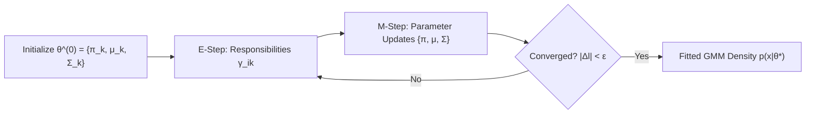

# Dempster, Laird, and Rubin (1977)
## "Maximum Likelihood from Incomplete Data via the EM Algorithm"
### 1-Page Executive & Technical Summary for Team Teaching and Viva Voce

**Full Citation:**  
Dempster, A. P., Laird, N. M., & Rubin, D. B. (1977). *Maximum Likelihood from Incomplete Data via the EM Algorithm.* **Journal of the Royal Statistical Society: Series B (Methodological)**, 39(1), 1–38. (Discussion: pp. 22–37).

---

### 1. Executive Summary & Core Contribution
Before 1977, ad-hoc iterative schemes existed for specific missing data and mixture problems, but statistics lacked a unified mathematical theory. Dempster, Laird, and Rubin synthesized these scattered techniques into a **general framework for maximum likelihood estimation in models with incomplete or latent data**: the **Expectation-Maximization (EM) algorithm**.

Their seminal contributions:
1. Formalized the mathematical distinction between **observed (incomplete) data** and **complete data** containing unobserved latent variables.
2. Formulated the iterative maximization of the surrogate function $Q(\boldsymbol{\theta} \mid \boldsymbol{\theta}^{(t)}) = \mathbb{E}_{\mathbf{Z} \mid \mathbf{X}, \boldsymbol{\theta}^{(t)}} [\ln p(\mathbf{X}, \mathbf{Z} \mid \boldsymbol{\theta})]$.
3. Provided a rigorous proof of **monotonic convergence**: each EM cycle is guaranteed to never decrease the marginal log-likelihood of the observed data, i.e., $\ln p(\mathbf{X} \mid \boldsymbol{\theta}^{(t+1)}) \ge \ln p(\mathbf{X} \mid \boldsymbol{\theta}^{(t)})$.

---

### 2. The Problem: The "Incomplete Data" Dilemma
In our unsupervised credit card fraud setup, we observe transaction vectors $\mathbf{X} = \{\mathbf{x}_1, \dots, \mathbf{x}_N\}$, but we do not know which underlying behavioral sub-population (e.g., small retail, recurring bill, high-value transfer) generated each transaction.

- **Observed (Incomplete) Data:** $\mathbf{X}$ with marginal likelihood $p(\mathbf{X} \mid \boldsymbol{\theta}) = \prod_{i=1}^N \sum_{k=1}^K \pi_k \mathcal{N}(\mathbf{x}_i \mid \boldsymbol{\mu}_k, \boldsymbol{\Sigma}_k)$.
- **Complete Data:** $\mathbf{Y} = (\mathbf{X}, \mathbf{Z})$, where $\mathbf{Z} = \{\mathbf{z}_1, \dots, \mathbf{z}_N\}$ is the latent categorical indicator matrix ($z_{ik} = 1$ if observation $i$ came from component $k$).

**Why Standard Calculus Fails:**  
The marginal log-likelihood contains a sum inside the logarithm:
$$\ln p(\mathbf{X} \mid \boldsymbol{\theta}) = \sum_{i=1}^N \ln \left( \sum_{k=1}^K \pi_k \mathcal{N}(\mathbf{x}_i \mid \boldsymbol{\mu}_k, \boldsymbol{\Sigma}_k) \right)$$
Setting $\nabla_{\boldsymbol{\theta}} \ln p(\mathbf{X} \mid \boldsymbol{\theta}) = \mathbf{0}$ yields an analytically intractable, non-linear coupled system of equations.

---

### 3. The EM Mathematical Decomposition
Dempster et al. decomposed the observed data log-likelihood $\ell(\boldsymbol{\theta}) = \ln p(\mathbf{X} \mid \boldsymbol{\theta})$ for any current estimate $\boldsymbol{\theta}^{(t)}$ as:
$$\ln p(\mathbf{X} \mid \boldsymbol{\theta}) = Q(\boldsymbol{\theta} \mid \boldsymbol{\theta}^{(t)}) - H(\boldsymbol{\theta} \mid \boldsymbol{\theta}^{(t)})$$
where:
$$Q(\boldsymbol{\theta} \mid \boldsymbol{\theta}^{(t)}) \equiv \mathbb{E}_{\mathbf{Z} \mid \mathbf{X}, \boldsymbol{\theta}^{(t)}} [\ln p(\mathbf{X}, \mathbf{Z} \mid \boldsymbol{\theta})] = \sum_{\mathbf{Z}} p(\mathbf{Z} \mid \mathbf{X}, \boldsymbol{\theta}^{(t)}) \ln p(\mathbf{X}, \mathbf{Z} \mid \boldsymbol{\theta})$$
$$H(\boldsymbol{\theta} \mid \boldsymbol{\theta}^{(t)}) \equiv \mathbb{E}_{\mathbf{Z} \mid \mathbf{X}, \boldsymbol{\theta}^{(t)}} [\ln p(\mathbf{Z} \mid \mathbf{X}, \boldsymbol{\theta})] = \sum_{\mathbf{Z}} p(\mathbf{Z} \mid \mathbf{X}, \boldsymbol{\theta}^{(t)}) \ln p(\mathbf{Z} \mid \mathbf{X}, \boldsymbol{\theta})$$

#### The Monotonicity Proof (Why EM Always Increases Likelihood)
Consider the change in log-likelihood between iterations:
$$\ell(\boldsymbol{\theta}^{(t+1)}) - \ell(\boldsymbol{\theta}^{(t)}) = \left[ Q(\boldsymbol{\theta}^{(t+1)} \mid \boldsymbol{\theta}^{(t)}) - Q(\boldsymbol{\theta}^{(t)} \mid \boldsymbol{\theta}^{(t)}) \right] - \left[ H(\boldsymbol{\theta}^{(t+1)} \mid \boldsymbol{\theta}^{(t)}) - H(\boldsymbol{\theta}^{(t)} \mid \boldsymbol{\theta}^{(t)}) \right]$$

1. **The M-step guarantees:** $\boldsymbol{\theta}^{(t+1)} = \arg\max_{\boldsymbol{\theta}} Q(\boldsymbol{\theta} \mid \boldsymbol{\theta}^{(t)}) \implies Q(\boldsymbol{\theta}^{(t+1)} \mid \boldsymbol{\theta}^{(t)}) - Q(\boldsymbol{\theta}^{(t)} \mid \boldsymbol{\theta}^{(t)}) \ge 0$.
2. **Jensen's Inequality / Information Inequality:**
   $$H(\boldsymbol{\theta}^{(t+1)} \mid \boldsymbol{\theta}^{(t)}) - H(\boldsymbol{\theta}^{(t)} \mid \boldsymbol{\theta}^{(t)}) = - D_{\text{KL}}\left( p(\mathbf{Z} \mid \mathbf{X}, \boldsymbol{\theta}^{(t)}) \,\parallel\, p(\mathbf{Z} \mid \mathbf{X}, \boldsymbol{\theta}^{(t+1)}) \right) \le 0$$
   Since the Kullback-Leibler divergence is strictly non-negative ($D_{\text{KL}} \ge 0$), subtracting a negative quantity guarantees:
   $$\ell(\boldsymbol{\theta}^{(t+1)}) - \ell(\boldsymbol{\theta}^{(t)}) \ge 0$$
Thus, **the observed-data log-likelihood increases monotonically at every single step.**

---

### 4. Step-by-Step EM for Gaussian Mixture Models

1. **E-Step (Expectation):**  
   Compute the posterior distribution (responsibilities) of the latent cluster memberships using current parameters $\boldsymbol{\theta}^{(t)}$ via Bayes' Theorem:
   $$\gamma_{ik} = P(z_{ik} = 1 \mid \mathbf{x}_i, \boldsymbol{\theta}^{(t)}) = \frac{\pi_k^{(t)} \mathcal{N}(\mathbf{x}_i \mid \boldsymbol{\mu}_k^{(t)}, \boldsymbol{\Sigma}_k^{(t)})}{\sum_{j=1}^K \pi_j^{(t)} \mathcal{N}(\mathbf{x}_i \mid \boldsymbol{\mu}_j^{(t)}, \boldsymbol{\Sigma}_j^{(t)})}$$
   *(Interpretation: "Soft-assigning" each transaction to all $K$ Gaussians in proportion to how well each Gaussian explains it).*

2. **M-Step (Maximization):**  
   Solve for $\boldsymbol{\theta}^{(t+1)}$ by maximizing the expected complete-data log-likelihood. Setting partial derivatives of $Q$ to zero yields closed-form analytical solutions:
   - **Effective Cluster Weight:** $N_k = \sum_{i=1}^N \gamma_{ik}$
   - **Component Priors:** $\pi_k^{(t+1)} = \frac{N_k}{N}$
   - **Component Means:** $\boldsymbol{\mu}_k^{(t+1)} = \frac{1}{N_k} \sum_{i=1}^N \gamma_{ik} \mathbf{x}_i$
   - **Component Covariances:** $\boldsymbol{\Sigma}_k^{(t+1)} = \frac{1}{N_k} \sum_{i=1}^N \gamma_{ik} (\mathbf{x}_i - \boldsymbol{\mu}_k^{(t+1)}) (\mathbf{x}_i - \boldsymbol{\mu}_k^{(t+1)})^T$

---

### 5. Strengths, Weaknesses & Practical Caveats
| Aspect | Theory & Practical Reality |
|---|---|
| **Strengths** | Stable, numerically robust; guaranteed non-decreasing likelihood; closed-form updates avoid tuning step sizes (learning rates); soft probabilistic assignment preserves uncertainty. |
| **Local Maxima** | EM guarantees convergence to a **stationary point** (local maximum or saddle point), **not** the global maximum. Requires multiple random initializations (`n_init > 1`). |
| **Singularities** | If a Gaussian collapses onto a single data point ($\boldsymbol{\mu}_k \to \mathbf{x}_i$) with covariance shrinking to zero ($|\boldsymbol{\Sigma}_k| \to 0$), the likelihood explodes to $+\infty$. Solved in code by adding a ridge regularizer (`reg_covar = 1e-6`). |
| **Convergence Rate** | Can exhibit slow first-order (linear) convergence in regions with high cluster overlap. |

---

### 6. Team Teaching Cheat-Sheet (How to Explain EM in 2 Minutes)
> *"Imagine a classic chicken-and-egg problem:  
> If we knew which cluster each card transaction belonged to, finding each Gaussian's mean and covariance would be trivial — just compute sample mean and sample covariance of each group.  
> Conversely, if we already knew each Gaussian's mean and covariance, assigning transactions to clusters would be trivial — just use Bayes' rule.  
> But we know neither!  
> Dempster et al. solved this by guessing the parameters first, using them in the **E-step** to make soft probabilistic assignments of transactions to clusters, and then using those assignments in the **M-step** to re-estimate the Gaussian parameters. Repeating this loop is mathematically proven to improve the model fit at every iteration until it settles into a stable optimum."*
