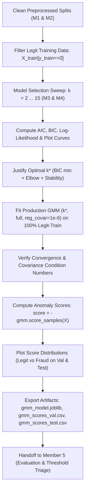

# Member 3: GMM Model Owner — Master Concept, Implementation & Viva Voce Guide
### Complete Theoretical, Practical & Oral Exam Reference for AI-Assisted Mastery
**Project:** Card Fraud Triage via Gaussian Mixture Density Scoring (Phase 1 — Machine Learning)  
**Author / Role:** Member 3 — Core Machine Learning & GMM Model Owner  
**Repository:** `Card-Fraud-Triage-ML-DL`

---

## 🤖 System Prompt for AI Tutors (Paste this document into ChatGPT / Claude / Gemini)

> **Prompt to copy-paste into any AI:**  
> *"You are an exacting Professor of Applied Machine Learning and Probability Theory conducting a rigorous Viva Voce oral examination for an AML + DL Master's course. Below is the complete project reference document authored by the student (Member 3: GMM Model Owner). Your objective is to thoroughly test, drill, and teach me all concepts in this document. Ask me tough, multi-part viva questions one by one. Probe my understanding of the EM algorithm step-by-step, the mathematical derivation of AIC vs BIC penalties, the geometric instability of covariance matrices in 29 dimensions, the exact role of `reg_covar`, and why negative log-likelihood is a valid anomaly score. If my answer is incomplete or mathematically imprecise, correct me and explain the concept using the exact formulations and intuitions provided below."*

---

# Table of Contents
1. [Master Glossary of Concepts & Terminology](#1-master-glossary-of-concepts--terminology)
2. [Concept 1: Gaussian Mixture Models (Generative Probabilistic Modeling)](#2-concept-1-gaussian-mixture-models-generative-probabilistic-modeling)
3. [Concept 2: The Expectation-Maximization (EM) Algorithm (Dempster et al., 1977)](#3-concept-2-the-expectation-maximization-em-algorithm-dempster-et-al-1977)
4. [Concept 3: Model Selection & Information Criteria (AIC vs BIC)](#4-concept-3-model-selection--information-criteria-aic-vs-bic)
5. [Concept 4: Covariance Topologies & High-Dimensional Geometry](#5-concept-4-covariance-topologies--high-dimensional-geometry)
6. [Concept 5: Unsupervised Anomaly Scoring via Negative Log-Likelihood](#6-concept-5-unsupervised-anomaly-scoring-via-negative-log-likelihood)
7. [Concept 6: Numerical Stability, Covariance Singularity & `reg_covar`](#7-concept-6-numerical-stability-covariance-singularity--reg_covar)
8. [Member 3 Implementation Walkthrough (Code & Engineering)](#8-member-3-implementation-walkthrough-code--engineering)
9. [Official Viva Voce Defense: Questions, Model Answers & Examiner Traps](#9-official-viva-voce-defense-questions-model-answers--examiner-traps)
10. [Theoretical Limitations & The Bridge to Phase 2 (Autoencoders)](#10-theoretical-limitations--the-bridge-to-phase-2-autoencoders)

---

# 1. Master Glossary of Concepts & Terminology

| Concept / Keyword | Formal Mathematical Definition | Plain English / Intuitive Meaning | Role in Member 3 Work |
|---|---|---|---|
| **Gaussian Mixture Model (GMM)** | $p(\mathbf{x}) = \sum_{k=1}^K \pi_k \mathcal{N}(\mathbf{x} \mid \boldsymbol{\mu}_k, \boldsymbol{\Sigma}_k)$ | A weighted sum of $K$ different Gaussian bell curves representing distinct behavioral modes. | The core unsupervised model used to estimate legitimate transaction density. |
| **Mixing Coefficient ($\pi_k$)** | Prior probability $\pi_k = P(z=k)$ with $\sum_{k=1}^K \pi_k = 1, \pi_k \ge 0$. | The proportion of the total population that belongs to cluster $k$. | Estimated in M-step as $N_k / N$. |
| **Unit Simplex ($\Delta^{K-1}$)** | $\Delta^{K-1} = \{\boldsymbol{\pi} \in \mathbb{R}^K \mid \pi_k \ge 0, \sum \pi_k = 1\}$. | The geometric constraint ensuring weights behave like valid probabilities. | Preserved during EM optimization using Lagrange multipliers. |
| **Latent Variable ($\mathbf{z}_i$)** | Unobserved 1-of-$K$ indicator vector $\mathbf{z}_i \in \{0, 1\}^K$, $\sum_k z_{ik} = 1$. | Hidden label indicating which Gaussian component generated transaction $i$. | The missing information that the EM algorithm estimates probabilistic soft weights for. |
| **Incomplete vs Complete Data** | Observed: $\mathbf{X}$; Complete: $(\mathbf{X}, \mathbf{Z})$. | Incomplete is what we see; Complete includes the hidden cluster labels. | The foundational framing of Dempster et al. (1977). |
| **Responsibility ($\gamma_{ik}$)** | Posterior expectation $\gamma_{ik} = P(z_{ik} = 1 \mid \mathbf{x}_i, \boldsymbol{\theta})$. | The "soft assignment": probability that transaction $i$ belongs to Gaussian $k$. | Computed in the **E-step** using Bayes' Theorem. |
| **Effective Cluster Size ($N_k$)** | $N_k = \sum_{i=1}^N \gamma_{ik}$. | The fractional sum of data points assigned to component $k$. | Denominator for updating component mean and covariance in the **M-step**. |
| **$Q$-Function (Auxiliary Function)** | $Q(\boldsymbol{\theta} \mid \boldsymbol{\theta}^{(t)}) = \mathbb{E}_{\mathbf{Z} \mid \mathbf{X}, \boldsymbol{\theta}^{(t)}} [\ln p(\mathbf{X}, \mathbf{Z} \mid \boldsymbol{\theta})]$. | The expected complete-data log-likelihood under current responsibilities. | The tractable surrogate objective maximized in the **M-step**. |
| **Jensen's Inequality** | For convex $f$, $\mathbb{E}[f(X)] \ge f(\mathbb{E}[X])$; for concave $\ln$, $\ln \mathbb{E}[X] \ge \mathbb{E}[\ln X]$. | The logarithm of an average is always greater than or equal to the average of the logarithms. | Proves that the Evidence Lower Bound (ELBO) never exceeds the true log-likelihood. |
| **Monotonicity Property** | $\ln p(\mathbf{X} \mid \boldsymbol{\theta}^{(t+1)}) \ge \ln p(\mathbf{X} \mid \boldsymbol{\theta}^{(t)})$. | Likelihood is mathematically guaranteed never to decrease between EM iterations. | Guarantees stable convergence without tuning learning rates or step sizes. |
| **AIC (Akaike Info Criterion)** | $\text{AIC} = 2p - 2\ln \hat{L}$. | Penalizes model complexity with a fixed penalty of $2$ per parameter. | Swept across $k=2\dots15$; overfits in large sample sizes. |
| **BIC (Bayesian Info Criterion)** | $\text{BIC} = p \ln(N) - 2\ln \hat{L}$. | Penalizes model complexity with $\ln(N)$ per parameter ($\approx 12.2$ for $N \approx 200k$). | Primary criterion for model selection; enforces parsimony and prevents overfitting. |
| **Parsimony (Occam's Razor)** | Preferring the simplest model that adequately explains the empirical data. | Not adding complex components unless they provide a substantial return in fit. | Justification for choosing $k=3$ or $k=4$ over higher $k$. |
| **Elbow Point / Inflection** | Point where the rate of marginal log-likelihood gain ($\Delta \text{LL}$) levels off. | The point of diminishing returns where adding another Gaussian yields negligible gain. | Used alongside minimum BIC to select optimal $k^*$. |
| **Full Covariance (`full`)** | Unconstrained $D \times D$ symmetric positive-definite matrix for each component. | Clusters can have any ellipsoidal shape, tilt, and orientation in 29-D space. | Captures correlations among features; requires regularizer to prevent collapse. |
| **Diagonal Covariance (`diag`)** | Diagonal matrix $\boldsymbol{\Sigma}_k = \text{diag}(\sigma_1^2, \dots, \sigma_D^2)$. | Clusters are axis-aligned ellipsoids; assumes features are conditionally independent. | Highly stable; $O(D)$ parameter scaling. |
| **Covariance Singularity** | Determinant $|\boldsymbol{\Sigma}_k| \to 0$, causing $(\boldsymbol{\Sigma}_k)^{-1}$ to explode to $\infty$. | A Gaussian collapsing onto a single point or flat plane, ruining density math. | Prevented via `reg_covar = 1e-6`. |
| **Regularization (`reg_covar`)** | $\tilde{\boldsymbol{\Sigma}}_k = \boldsymbol{\Sigma}_k + \epsilon \mathbf{I}$. | Adding a tiny positive constant to the diagonal of the covariance matrix. | Ensures all eigenvalues are strictly positive ($\lambda_{\min} \ge \epsilon > 0$). |
| **Condition Number ($\kappa$)** | $\kappa(\boldsymbol{\Sigma}) = \lambda_{\max} / \lambda_{\min}$. | Ratio of the longest axis to the shortest axis of the Gaussian ellipsoid. | Diagnostic measure of numerical stability; verified across all fitted components. |
| **Negative Log-Likelihood ($-\ln p(\mathbf{x})$)** | $s(\mathbf{x}) = -\ln \sum_{k=1}^K \pi_k \mathcal{N}(\mathbf{x} \mid \boldsymbol{\mu}_k, \boldsymbol{\Sigma}_k)$. | Negative natural log of the probability density of a transaction under legitimate model. | The formal **Anomaly Score**; higher values indicate higher suspicion. |
| **Surprisal (Self-Information)** | $I(x) = -\log_2 p(x)$. | Information-theoretic measure of how unexpected an event is. | Theoretical basis for why $-\ln p(\mathbf{x})$ is an ideal anomaly metric. |
| **Curse of Dimensionality** | Counter-intuitive geometric properties in high-dimensional space ($D=29$). | High-dimensional space is virtually empty; data concentrates in thin outer shells. | Explains why GMMs become unstable and motivates Phase 2 Autoencoders. |
| **Soap Bubble Effect** | Multivariate Gaussian probability mass concentrates in a thin spherical shell. | Almost no points are near the mean; all points lie at distance $r \approx \sqrt{D}$. | Fundamental high-dimensional property limiting classical density models. |

---

# 2. Concept 1: Gaussian Mixture Models (Generative Probabilistic Modeling)

### What is a GMM?
A Gaussian Mixture Model is a **generative probabilistic model** that assumes all continuous data points are generated from a mixture of a finite number of Gaussian distributions with unknown parameters.

### Mathematical Formulation
The continuous marginal probability density function of a $D$-dimensional observation $\mathbf{x} \in \mathbb{R}^D$ is:
$$p(\mathbf{x} \mid \boldsymbol{\theta}) = \sum_{k=1}^K \pi_k \mathcal{N}(\mathbf{x} \mid \boldsymbol{\mu}_k, \boldsymbol{\Sigma}_k)$$

Where:
- $K$: Number of Gaussian components (clusters).
- $\pi_k = P(z = k)$: The **mixture weight** (prior probability) of component $k$.
  - Simplex constraints: $\pi_k \ge 0$ for all $k$, and $\sum_{k=1}^K \pi_k = 1$.
- $\boldsymbol{\mu}_k \in \mathbb{R}^D$: Mean vector (centroid) of component $k$.
- $\boldsymbol{\Sigma}_k \in \mathbb{S}_{++}^D$: Symmetric positive-definite $D \times D$ covariance matrix of component $k$.
- $\mathcal{N}(\mathbf{x} \mid \boldsymbol{\mu}_k, \boldsymbol{\Sigma}_k)$: The multivariate Gaussian density:
  $$\mathcal{N}(\mathbf{x} \mid \boldsymbol{\mu}_k, \boldsymbol{\Sigma}_k) = \frac{1}{(2\pi)^{D/2} |\boldsymbol{\Sigma}_k|^{1/2}} \exp \left( -\frac{1}{2} (\mathbf{x} - \boldsymbol{\mu}_k)^T \boldsymbol{\Sigma}_k^{-1} (\mathbf{x} - \boldsymbol{\mu}_k) \right)$$

### Why Does a GMM Give a Valid Probability Density?
To be a mathematically valid probability density function, $p(\mathbf{x})$ must satisfy two axioms:
1. **Non-negativity:** $p(\mathbf{x}) \ge 0$ for all $\mathbf{x} \in \mathbb{R}^D$.  
   *Proof:* Since $\pi_k \ge 0$ and each Gaussian $\mathcal{N}(\mathbf{x} \mid \boldsymbol{\mu}_k, \boldsymbol{\Sigma}_k) > 0$ everywhere (the exponential function is strictly positive and the determinant $|\boldsymbol{\Sigma}_k| > 0$ for positive-definite matrices), the product and sum of positive quantities is strictly positive.
2. **Total Probability Mass Equals 1 (Integrates to 1):**  
   $$\int_{\mathbb{R}^D} p(\mathbf{x}) \, d\mathbf{x} = 1$$
   *Proof:*
   $$\int_{\mathbb{R}^D} \left( \sum_{k=1}^K \pi_k \mathcal{N}(\mathbf{x} \mid \boldsymbol{\mu}_k, \boldsymbol{\Sigma}_k) \right) d\mathbf{x} = \sum_{k=1}^K \pi_k \left( \int_{\mathbb{R}^D} \mathcal{N}(\mathbf{x} \mid \boldsymbol{\mu}_k, \boldsymbol{\Sigma}_k) \, d\mathbf{x} \right)$$
   Since every multivariate normal density integrates to $1$ over $\mathbb{R}^D$:
   $$= \sum_{k=1}^K \pi_k (1) = \sum_{k=1}^K \pi_k = 1$$

---

# 3. Concept 2: The Expectation-Maximization (EM) Algorithm (Dempster et al., 1977)

### Why Can't We Just Use Standard Maximum Likelihood (MLE)?
Given $N$ independent training samples $\mathbf{X} = \{\mathbf{x}_1, \dots, \mathbf{x}_N\}$, the marginal log-likelihood is:
$$\ln p(\mathbf{X} \mid \boldsymbol{\theta}) = \sum_{i=1}^N \ln \left( \sum_{k=1}^K \pi_k \mathcal{N}(\mathbf{x}_i \mid \boldsymbol{\mu}_k, \boldsymbol{\Sigma}_k) \right)$$

Notice that the **summation over $k$ appears inside the natural logarithm**.
If you attempt to compute the gradient $\nabla_{\boldsymbol{\mu}_k} \ln p(\mathbf{X} \mid \boldsymbol{\theta}) = 0$, the derivative of $\ln(u)$ is $\frac{1}{u} \frac{du}{dx}$, which couples the parameters of all $K$ Gaussians together into a complex, non-linear algebraic system. There is **no closed-form analytical solution**.

### The Latent Variable Framework (Dempster et al., 1977)
Dempster, Laird, and Rubin recognized that if we knew which Gaussian generated each observation, the problem would decouple into $K$ simple, independent Gaussian estimations.
- Let $\mathbf{z}_i = (z_{i1}, z_{i2}, \dots, z_{iK})^T$ be an unobserved binary indicator vector where $z_{ik} = 1$ if observation $i$ was produced by component $k$, and $0$ otherwise.
- The **Complete Data** is $\mathbf{Y} = (\mathbf{X}, \mathbf{Z})$.
- The complete-data log-likelihood is:
  $$\ln p(\mathbf{X}, \mathbf{Z} \mid \boldsymbol{\theta}) = \sum_{i=1}^N \sum_{k=1}^K z_{ik} \left[ \ln \pi_k + \ln \mathcal{N}(\mathbf{x}_i \mid \boldsymbol{\mu}_k, \boldsymbol{\Sigma}_k) \right]$$
  Notice that here, the logarithm acts **directly on the individual Gaussian density**, completely removing the intractable sum inside the log!

### Derivation via Jensen's Inequality & Lower Bound
For any arbitrary distribution $q(\mathbf{Z})$ over the latent variables:
$$\ln p(\mathbf{X} \mid \boldsymbol{\theta}) = \sum_{\mathbf{Z}} q(\mathbf{Z}) \ln \frac{p(\mathbf{X}, \mathbf{Z} \mid \boldsymbol{\theta})}{q(\mathbf{Z})} + D_{\text{KL}}(q(\mathbf{Z}) \parallel p(\mathbf{Z} \mid \mathbf{X}, \boldsymbol{\theta}))$$

Because the Kullback-Leibler divergence is always non-negative ($D_{\text{KL}} \ge 0$), we obtain the **Evidence Lower Bound (ELBO)**:
$$\mathcal{L}(q, \boldsymbol{\theta}) = \sum_{\mathbf{Z}} q(\mathbf{Z}) \ln \frac{p(\mathbf{X}, \mathbf{Z} \mid \boldsymbol{\theta})}{q(\mathbf{Z})} \le \ln p(\mathbf{X} \mid \boldsymbol{\theta})$$

The EM algorithm performs coordinate ascent on $\mathcal{L}(q, \boldsymbol{\theta})$:
1. **E-Step:** Maximize $\mathcal{L}$ with respect to $q$ by setting $q(\mathbf{Z}) = p(\mathbf{Z} \mid \mathbf{X}, \boldsymbol{\theta}^{(t)})$, driving $D_{\text{KL}} = 0$ and making the bound tight.
2. **M-Step:** Maximize $\mathcal{L}$ with respect to $\boldsymbol{\theta}$.

### Step-by-Step EM Operations

#### Step 1: Initialization
Initialize parameters $\boldsymbol{\theta}^{(0)} = \{\pi_k^{(0)}, \boldsymbol{\mu}_k^{(0)}, \boldsymbol{\Sigma}_k^{(0)}\}_{k=1}^K$ (typically using $k$-means clustering centroids for means, isotropic identity matrices for covariances, and uniform mixing weights $\pi_k = 1/K$).

#### Step 2: Expectation Step (E-Step)
Evaluate the posterior probability (responsibility) $\gamma_{ik}$ that component $k$ generated transaction $\mathbf{x}_i$ under current parameters $\boldsymbol{\theta}^{(t)}$:
$$\gamma_{ik} \equiv P(z_{ik} = 1 \mid \mathbf{x}_i, \boldsymbol{\theta}^{(t)}) = \frac{\pi_k^{(t)} \mathcal{N}(\mathbf{x}_i \mid \boldsymbol{\mu}_k^{(t)}, \boldsymbol{\Sigma}_k^{(t)})}{\sum_{j=1}^K \pi_j^{(t)} \mathcal{N}(\mathbf{x}_i \mid \boldsymbol{\mu}_j^{(t)}, \boldsymbol{\Sigma}_j^{(t)})}$$
- $\gamma_{ik} \in [0, 1]$ represents a "soft assignment".
- $\sum_{k=1}^K \gamma_{ik} = 1$ for each observation $i$.

#### Step 3: Maximization Step (M-Step)
Re-estimate parameters $\boldsymbol{\theta}^{(t+1)}$ to maximize the expected complete-data log-likelihood:
1. **Effective number of samples in cluster $k$:**
   $$N_k = \sum_{i=1}^N \gamma_{ik}$$
2. **Update mixing weights $\pi_k$:**
   $$\pi_k^{(t+1)} = \frac{N_k}{N}$$
3. **Update mean vectors $\boldsymbol{\mu}_k$:**
   $$\boldsymbol{\mu}_k^{(t+1)} = \frac{1}{N_k} \sum_{i=1}^N \gamma_{ik} \mathbf{x}_i$$
4. **Update covariance matrices $\boldsymbol{\Sigma}_k$:**
   $$\boldsymbol{\Sigma}_k^{(t+1)} = \frac{1}{N_k} \sum_{i=1}^N \gamma_{ik} (\mathbf{x}_i - \boldsymbol{\mu}_k^{(t+1)}) (\mathbf{x}_i - \boldsymbol{\mu}_k^{(t+1)})^T$$

#### Step 4: Convergence Check
Evaluate the marginal log-likelihood:
$$\ln p(\mathbf{X} \mid \boldsymbol{\theta}^{(t+1)}) = \sum_{i=1}^N \ln \left( \sum_{k=1}^K \pi_k^{(t+1)} \mathcal{N}(\mathbf{x}_i \mid \boldsymbol{\mu}_k^{(t+1)}, \boldsymbol{\Sigma}_k^{(t+1)}) \right)$$
If $|\ln p(\mathbf{X} \mid \boldsymbol{\theta}^{(t+1)}) - \ln p(\mathbf{X} \mid \boldsymbol{\theta}^{(t)})| < \text{tol}$, terminate and return $\hat{\boldsymbol{\theta}}$. Otherwise, return to the E-step.

---

# 4. Concept 3: Model Selection & Information Criteria (AIC vs BIC)

### Formulas:
$$\text{AIC} = 2p - 2\ln \hat{L}$$
$$\text{BIC} = p \ln(N) - 2\ln \hat{L}$$

Where:
- $\hat{L} = p(\mathbf{X} \mid \hat{\boldsymbol{\theta}})$: Maximized observed-data likelihood.
- $N$: Number of training observations ($N \approx 199,000$).
- $p$: Total number of freely estimated parameters.

### Counting Free Parameters ($p$) in $D=29$ Dimensions:
For $K$ components:
- Mixture weights: $K - 1$ degrees of freedom (since $\sum \pi_k = 1$).
- Mean vectors: $K \cdot D$ parameters ($29K$).
- Covariance parameters:
  - `full`: Each component has a symmetric $D \times D$ matrix $\implies K \cdot \frac{D(D+1)}{2} = K \cdot \frac{29 \times 30}{2} = 435K$.
  - Total for `full`: $p = (K-1) + 29K + 435K = 464K + K - 1$.
  - For $K=4$, $p = 465 \times 4 - 1 = 1,859$ parameters!

### Why BIC Penalizes Complexity Much More Than AIC:
Compare the penalties:
$$\text{Penalty}_{\text{AIC}} = 2 \cdot p$$
$$\text{Penalty}_{\text{BIC}} = \ln(N) \cdot p$$

Ratio of penalty strength:
$$\frac{\text{Penalty}_{\text{BIC}}}{\text{Penalty}_{\text{AIC}}} = \frac{\ln(N)}{2}$$

For our dataset with $N = 199,000$ legitimate transactions:
$$\ln(199,000) \approx 12.20 \implies \frac{12.20}{2} = 6.10$$
**BIC penalizes every added parameter more than $6\times$ harsher than AIC!**

### Why AIC Overfits in Big Data & Why BIC is Better:
- **AIC (Akaike, 1974):** Derived from Kullback-Leibler prediction divergence. As $N \to \infty$, the penalty $2p$ remains constant while the log-likelihood term scales as $O(N)$. Consequently, with large datasets, AIC will continually add parameters to fit tiny stochastic fluctuations, **chronically selecting too many clusters ($K$)**.
- **BIC (Schwarz, 1978):** Derived from Bayesian marginal likelihood. The penalty $\ln(N)p$ grows with sample size. BIC is **dimensionally consistent**: as $N \to \infty$, the probability of BIC selecting the true number of generative clusters approaches $1$.

### Why "Lowest Number Wins" is a Dangerous Fallacy:
If an engineer blindly selects $k$ solely because "the metric was lowest by 0.1%", they ignore:
1. **Numerical Singularity:** High $k$ divides samples among too many components, creating small clusters with near-singular covariance matrices.
2. **Overfitting to Artifacts:** Excess components model noise or rare outliers instead of genuine transaction archetypes.
3. **Elbow Principle:** If increasing from $k=4$ to $k=5$ yields a tiny $\Delta \text{BIC}$ drop of $0.05\%$ but adds $465$ parameters, Occam's razor dictates choosing $k=4$ for parsimony and robustness.

---

# 5. Concept 4: Covariance Topologies & High-Dimensional Geometry

### The Four Covariance Structures:
1. **Full (`full`):** $\boldsymbol{\Sigma}_k$ is an unconstrained symmetric positive-definite matrix.
   - Geometry: Super-ellipsoids with independent orientations, scales, and axis rotations.
   - Freedom: Captures localized correlations between any pair of features (e.g., $V_4$ and Amount).
2. **Diagonal (`diag`):** $\boldsymbol{\Sigma}_k = \text{diag}(\sigma_{k,1}^2, \dots, \sigma_{k,D}^2)$.
   - Geometry: Axis-aligned ellipsoids.
   - Assumption: Features are conditionally independent given cluster assignment.
   - Parameter scaling: $O(K \cdot D)$ instead of $O(K \cdot D^2)$. Extremely fast and numerically stable.
3. **Tied (`tied`):** $\boldsymbol{\Sigma}_1 = \boldsymbol{\Sigma}_2 = \dots = \boldsymbol{\Sigma}_K = \boldsymbol{\Sigma}$.
   - Geometry: All clusters share the exact same ellipsoidal shape and orientation; only centroids differ.
   - Advantage: Highly stable because covariance is estimated using all $N$ data points pooled together.
4. **Spherical (`spherical`):** $\boldsymbol{\Sigma}_k = \sigma_k^2 \mathbf{I}$.
   - Geometry: Hyperspherical clusters (equal variance in all 29 dimensions).
   - Limitation: Highly restrictive; assumes spherical symmetry.

### The Curse of Dimensionality in 29 Dimensions:
In high dimensions, our 3D geometric intuition completely fails:
1. **Volume Growth:** The volume of a $D$-dimensional hypersphere of radius $r$ is $V_D(r) = \frac{\pi^{D/2}}{\Gamma(D/2 + 1)} r^D$. As $D$ increases, volume grows exponentially with radius.
2. **The Soap Bubble Effect:** The probability mass of a multivariate Gaussian does **not** reside near the mean! In $D=29$, the radial distance $r = \sqrt{(\mathbf{x} - \boldsymbol{\mu})^T \boldsymbol{\Sigma}^{-1} (\mathbf{x} - \boldsymbol{\mu})}$ follows a Chi distribution with 29 degrees of freedom. Almost all mass is concentrated in a thin spherical shell at distance $r \approx \sqrt{D} = \sqrt{29} \approx 5.38$. The center is virtually empty!
3. **Distance Concentration:** The ratio $\frac{\text{dist}_{\max} - \text{dist}_{\min}}{\text{dist}_{\min}} \to 0$ as $D \to \infty$. All transactions begin to appear equidistant from the cluster centers, degrading contrast between normal transactions and mild anomalies.

---

# 6. Concept 5: Unsupervised Anomaly Scoring via Negative Log-Likelihood

### How Does Anomaly Detection Work Without Fraud Labels?
In supervised learning, models learn $P(\text{Fraud} \mid \mathbf{x})$.
In unsupervised density-based fraud triage:
1. We fit the GMM **exclusively on legitimate card transactions**: $p_{\text{legit}}(\mathbf{x})$.
2. The GMM acts as a statistical model of **normal human purchasing habits**.
3. Any transaction that falls outside normal patterns has a very low probability density.

### The Anomaly Scoring Formula:
$$\text{score}(\mathbf{x}) = -\ln p(\mathbf{x} \mid \hat{\boldsymbol{\theta}}) = -\ln \left( \sum_{k=1}^K \pi_k \mathcal{N}(\mathbf{x} \mid \boldsymbol{\mu}_k, \boldsymbol{\Sigma}_k) \right)$$

### Why is $-\ln p(\mathbf{x})$ a Valid Anomaly Score?
1. **Inverse Relationship:**
   - Common legitimate transactions reside in high-density regions $\implies p(\mathbf{x})$ is high $\implies -\ln p(\mathbf{x})$ is **low**.
   - Anomalous / fraud transactions reside in sparse peripheral voids $\implies p(\mathbf{x}) \to 0^+ \implies -\ln p(\mathbf{x})$ is **high**.
2. **Strict Monotonicity:**
   $f(u) = -\ln(u)$ is strictly decreasing for $u > 0$. Therefore:
   $$p(\mathbf{x}_1) < p(\mathbf{x}_2) \iff \text{score}(\mathbf{x}_1) > \text{score}(\mathbf{x}_2)$$
   The ranking of transactions is perfectly preserved.
3. **Prevention of Arithmetic Underflow:**
   In 29 dimensions, evaluating joint probability density directly produces numbers like $10^{-45}$. Standard computer registers underflow this to $0.0$, making two different rare transactions indistinguishable ($0 == 0$). In the log-domain, $-\ln(10^{-45}) \approx 103.6$, preserving precise ranking differences.
4. **Surprisal (Self-Information):**
   In information theory, $I(\mathbf{x}) = -\log_2 p(\mathbf{x})$ measures **surprisal**. Rare events convey high information content. An anomaly score of 120 means the transaction is astronomically surprising under normal behavior.

---

# 7. Concept 6: Numerical Stability, Covariance Singularity & `reg_covar`

### What is Covariance Singularity?
In the multivariate Gaussian density, evaluating the density requires computing:
1. The determinant $|\boldsymbol{\Sigma}_k|$.
2. The inverse matrix $\boldsymbol{\Sigma}_k^{-1}$.

If any component $k$ has an eigenvalue $\lambda_i \to 0$:
- The determinant $|\boldsymbol{\Sigma}_k| = \prod_{i=1}^D \lambda_i \to 0$.
- The inverse $\boldsymbol{\Sigma}_k^{-1}$ requires dividing by $\lambda_i \to \infty$.
- The log-likelihood term $-\frac{1}{2} \ln |\boldsymbol{\Sigma}_k| \to +\infty$.
The model experiences an artificial "explosion" of infinite likelihood, causing Python to crash with `LinAlgError: Matrix is singular`.

### Why Does This Happen in Fraud Datasets?
1. **Component Collapse:** A Gaussian component's mean $\boldsymbol{\mu}_k$ lands exactly on a single data point $\mathbf{x}_i$, and its variance contracts to zero around that single point.
2. **Multicollinearity:** If features in a local cluster lie on a lower-dimensional subspace (e.g. $D=29$ but local variation is only 20D), the remaining 9 eigenvalues are zero.

### What Does `reg_covar` Do Mathematically?
`reg_covar` implements **Tikhonov regularization (ridge shrinkage)** directly onto the covariance matrices:
$$\tilde{\boldsymbol{\Sigma}}_k = \boldsymbol{\Sigma}_k + \epsilon \mathbf{I}_D$$

Where:
- $\epsilon > 0$ is a small scalar (in our code, $\epsilon = 10^{-6}$).
- $\mathbf{I}_D$ is the $D \times D$ identity matrix.

#### Mathematical Consequences of Adding $\epsilon \mathbf{I}$:
1. **Eigenvalue Shift:** If the original eigenvalues of $\boldsymbol{\Sigma}_k$ are $\lambda_1, \dots, \lambda_D$, the regularized eigenvalues become:
   $$\tilde{\lambda}_i = \lambda_i + \epsilon$$
2. **Strict Positive Definiteness:** Even if $\lambda_{\min} = 0$, the new eigenvalue $\tilde{\lambda}_{\min} \ge \epsilon > 0$. The determinant $|\tilde{\boldsymbol{\Sigma}}_k| \ge \epsilon^D > 0$, guaranteeing that the matrix is **invertible under all conditions**.
3. **Condition Number Bounding:** The condition number $\kappa(\tilde{\boldsymbol{\Sigma}}_k) = \frac{\lambda_{\max} + \epsilon}{\lambda_{\min} + \epsilon}$ remains finite and well-behaved, eliminating numerical overflow/underflow.

---

# 8. Member 3 Implementation Walkthrough (Code & Engineering)

### Architecture in `notebooks/Card_Fraud_Triage_Phase1.ipynb`:

### Key Engineering Safeguards in Our Code:
1. **Strict Data Leakage Prevention:**
   - Filter `X_train_legit = X_train[y_train == 0]`.
   - Never pass `y_train == 1` into GMM `.fit()`.
   - Scaler was already fit on legit-train in Section 4.
2. **Sweep Efficiency:**
   - `SWEEP_SAMPLE_SIZE = min(50000, len(X_train_legit))` with fixed `SEED = 42`.
   - Allows the 14-model sweep ($k=2\dots15$) to complete within ~45 seconds on Colab CPU while maintaining statistical power ($N=50,000$ represents $>25\%$ of data).
3. **Numerical Assertions:**
   - `assert gmm_final.converged_`: Proves EM reached convergence tolerance.
   - `np.linalg.eigvalsh(cov)`: Proves all eigenvalues are positive and prints condition numbers.
   - `assert not np.isnan(score_val).any()`: Proves no division by zero or NaN propagation.

---

# 9. Official Viva Voce Defense: Questions, Model Answers & Examiner Traps

### Viva Question 1: Explain the EM algorithm step-by-step. Why does a GMM give a probability density?

#### Ideal Model Answer:
> *"A Gaussian Mixture Model models the probability density of an observation $\mathbf{x}$ as a convex combination of $K$ multivariate Gaussian densities: $p(\mathbf{x}) = \sum_{k=1}^K \pi_k \mathcal{N}(\mathbf{x} \mid \boldsymbol{\mu}_k, \boldsymbol{\Sigma}_k)$.  
> It gives a mathematically valid probability density because:  
> 1) It is non-negative everywhere, as mixing weights $\pi_k \ge 0$ and normal densities are strictly positive.  
> 2) It integrates to exactly 1 over $\mathbb{R}^D$ because each Gaussian integrates to 1, and the mixing weights sum to 1 ($\sum \pi_k = 1$).  
>  
> We cannot fit this model with standard analytical maximum likelihood because the sum over $K$ is inside the logarithm of the marginal likelihood, preventing closed-form derivatives.  
>  
> The Expectation-Maximization (EM) algorithm by Dempster et al. (1977) solves this using an unobserved indicator variable $\mathbf{z}_i$:  
> - **Initialization:** Initialize means (using k-means), covariances (identity), and weights ($1/K$).  
> - **E-Step (Expectation):** Use Bayes' theorem to compute the posterior responsibility $\gamma_{ik}$—the probability that Gaussian $k$ generated transaction $i$ under current parameters:  
>   $$\gamma_{ik} = \frac{\pi_k^{(t)} \mathcal{N}(\mathbf{x}_i \mid \boldsymbol{\mu}_k^{(t)}, \boldsymbol{\Sigma}_k^{(t)})}{\sum_j \pi_j^{(t)} \mathcal{N}(\mathbf{x}_i \mid \boldsymbol{\mu}_j^{(t)}, \boldsymbol{\Sigma}_j^{(t)})}$$  
> - **M-Step (Maximization):** Update parameters analytically by maximizing the expected complete-data log-likelihood ($Q$-function):  
>   - Effective weight: $N_k = \sum_i \gamma_{ik}$  
>   - New weight: $\pi_k^{(t+1)} = N_k / N$  
>   - New mean: $\boldsymbol{\mu}_k^{(t+1)} = \frac{1}{N_k} \sum_i \gamma_{ik} \mathbf{x}_i$  
>   - New covariance: $\boldsymbol{\Sigma}_k^{(t+1)} = \frac{1}{N_k} \sum_i \gamma_{ik} (\mathbf{x}_i - \boldsymbol{\mu}_k^{(t+1)}) (\mathbf{x}_i - \boldsymbol{\mu}_k^{(t+1)})^T$  
> - **Convergence:** Dempster et al. proved that observed log-likelihood increases monotonically at every step ($\Delta \ell \ge 0$) until the change drops below tolerance."*

#### ⚠️ Examiner Follow-Up Trap:
- **Trap:** *"Does the EM algorithm guarantee finding the global maximum likelihood?"*
- **Correct Answer:** *"No! EM guarantees convergence only to a **local stationary point** (local maximum or saddle point) of the likelihood surface. That is why we set `n_init = 3` with different random seeds to initialize from multiple points and select the solution with the highest converged lower bound."*

---

### Viva Question 2: AIC vs BIC — formulas, how the penalty differs, why BIC penalises complexity more.

#### Ideal Model Answer:
> *"The formulas are:  
> - $\text{AIC} = 2p - 2\ln \hat{L}$  
> - $\text{BIC} = p \ln(N) - 2\ln \hat{L}$  
> where $\hat{L}$ is the maximized likelihood, $p$ is the number of free parameters, and $N$ is sample size.  
>  
> The difference lies entirely in the complexity penalty:  
> AIC penalizes complexity with a fixed factor of $2 \times p$, independent of sample size.  
> BIC penalizes complexity with $\ln(N) \times p$, which scales logarithmically with sample size.  
>  
> In our dataset, we train on $N \approx 199,000$ legitimate transactions. Therefore:  
> $$\ln(199,000) \approx 12.20$$  
> The penalty ratio is:  
> $$\frac{\text{BIC penalty}}{\text{AIC penalty}} = \frac{\ln(N)}{2} \approx \frac{12.20}{2} = 6.10$$  
> BIC penalizes every single added parameter more than $6\times$ harsher than AIC.  
>  
> **Why this matters:**  
> AIC was derived from minimizing predictive KL divergence. In large datasets, the $2p$ penalty is too weak compared to the $O(N)$ likelihood gain, so AIC continually adds components and overfits to noise. BIC was derived from Bayesian marginal likelihood and is dimensionally consistent: as $N \to \infty$, it converges to the true parsimonious model. Hence, we use BIC minimum and the elbow curve for model selection."*

#### ⚠️ Examiner Follow-Up Trap:
- **Trap:** *"If BIC was minimum at $k=8$ by a tiny margin, would you pick $k=8$?"*
- **Correct Answer:** *"No. We do not follow 'lowest number wins'. In 29 dimensions, each extra component adds 465 parameters. If $k=8$ is only marginally lower than $k=4$, Occam's razor and numerical stability favor $k=4$ because fewer components maintain higher degrees of freedom per covariance matrix and prevent high-dimensional singularity."*

---

### Viva Question 3: Why can a GMM become unstable in high dimensions? (Covariance singularity, curse of dimensionality)

#### Ideal Model Answer:
> *"A GMM faces two severe challenges in high dimensions ($D=29$):  
> 1. **Covariance Singularity:** In 29 dimensions, a full covariance matrix requires estimating $\frac{D(D+1)}{2} = 435$ parameters per component. If a component attracts too few data points, or if points in that cluster lie along a lower-dimensional manifold (high multicollinearity), the empirical covariance matrix becomes rank-deficient: its smallest eigenvalue $\lambda_{\min} \to 0$, its determinant $|\boldsymbol{\Sigma}_k| \to 0$, and inverting it blows up to infinity ($\boldsymbol{\Sigma}_k^{-1} \to \infty$).  
> 2. **Curse of Dimensionality (The Soap Bubble Effect):** In 29 dimensions, space is exponentially vast. Multivariate Gaussian probability mass does not sit in the center around the mean; it concentrates in a thin spherical shell at distance $r \approx \sqrt{D}$ from the center. Furthermore, distance concentration causes the ratio between nearest and farthest points to contract toward 1, making normal points and mild anomalies look almost equidistant from cluster centers."*

---

### Viva Question 4: Why is −log-likelihood a valid anomaly score? What does `reg_covar` do?

#### Ideal Model Answer:
> *"Negative log-likelihood $-\ln p(\mathbf{x})$ is a valid anomaly score because:  
> 1. **Inverse Density Relationship:** We train our GMM strictly on legitimate transactions. Common legitimate transactions fall in dense, high-probability regions of feature space where $p(\mathbf{x})$ is high, producing a low $-\ln p(\mathbf{x})$. Fraudulent transactions violate legitimate patterns, falling in sparse, low-density regions where $p(\mathbf{x}) \to 0^+$, driving $-\ln p(\mathbf{x})$ toward $+\infty$.  
> 2. **Strict Monotonicity:** Because $-\ln(u)$ is strictly decreasing, lower probability density translates directly and monotonically into a higher anomaly score.  
> 3. **Underflow Prevention:** Raw 29-D probabilities are on the order of $10^{-50}$, which underflow standard float64 registers to 0.0. The negative logarithm converts these infinitesimal densities into well-behaved positive numbers like $25.0$ or $120.0$.  
>  
> **What `reg_covar` does:**  
> `reg_covar = 1e-6` adds a small positive constant $\epsilon$ to the diagonal of every covariance matrix:  
> $$\tilde{\boldsymbol{\Sigma}}_k = \boldsymbol{\Sigma}_k + \epsilon \mathbf{I}$$  
> This performs Tikhonov regularization. It shifts every eigenvalue $\lambda_i \to \lambda_i + \epsilon$, guaranteeing that $\lambda_{\min} \ge \epsilon > 0$. This ensures the determinant is strictly non-zero, bounds the condition number, and mathematically guarantees the covariance matrix is always invertible, preventing singular matrix crashes."*

---

# 10. Theoretical Limitations & The Bridge to Phase 2 (Autoencoders)

### Why is GMM Not Enough for Real-World Banking?
1. **Convex Gaussian Manifold Limitation:** Human spending behavior follows non-linear, topological manifolds (e.g. spiral spending velocities, temporal bursts). A GMM tries to approximate non-linear manifolds using a collection of convex, elliptical blobs, which requires too many components and leads to singularity.
2. **Phase 2 Solution — Deep Autoencoders:**  
   In Phase 2, a Deep Autoencoder with non-linear activation functions (ReLU, GELU) compresses 29 features down to a low-dimensional bottleneck (e.g., 10D) and reconstructs them. Reconstruction error $e_{\text{recon}}(\mathbf{x}) = \|\mathbf{x} - \hat{\mathbf{x}}\|^2$ captures arbitrary non-linear manifolds without making rigid Gaussian assumptions.
3. **Phase 2 Hybrid Fusion:**  
   Combining GMM density score ($-\ln p(\mathbf{x})$) with Autoencoder reconstruction error ($e_{\text{recon}}(\mathbf{x})$) combines **probabilistic volume density** with **topological reconstruction fidelity**, creating a far more powerful fraud triage engine.
