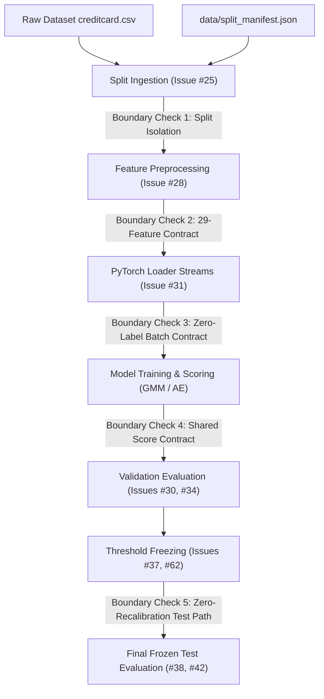

# Phase 2 Integrated Data-to-Score Workflow & Regression Architecture

This document specifies the integrated end-to-end execution workflow, stage boundary contract verifications, and frozen test evaluation path implemented for **Issue #42**.

---

## 1. Workflow Architecture & Stage Boundaries

The integrated workflow connects the independently developed Phase 2 components into a unified, reproducible pipeline governed by strict boundary validation contracts.



### Stage Boundary Contracts

1. **Split Isolation (`validate_split_isolation`)**:
   - `train_legit` must contain strictly 0 fraud transactions (`Class == 0`).
   - `train`, `val`, and `test` partitions must be mutually pairwise disjoint (`set(train) & set(val) == set(val) & set(test) == set(train) & set(test) == ∅`).
   - Labels are isolated from input features.
2. **29-Feature Contract (`validate_feature_contract`)**:
   - Exactly 29 continuous features in canonical order: `V1`..`V28` followed by `Amount_log = log1p(Amount)`.
   - Raw `Class`, `Time`, and untransformed `Amount` are strictly forbidden in feature space.
   - All matrices must be 2D float arrays with all finite values (`np.isfinite`).
   - `RobustScaler` is fitted exclusively on legitimate training samples (`train_legit`).
3. **Loader Streams Contract (`validate_loader_streams`)**:
   - Four dedicated streams: `train`, `val_legit`, `val_ranking`, `test`.
   - Training stream collates `(x_input, x_target, row_id)` with shape `(B, 29)`, `(B, 29)`, `(B,)`.
   - Evaluation streams collate `(x, row_id)` with shape `(B, 29)`, `(B,)`.
   - **Zero-Label Guarantee**: No DataLoader batch yields transaction labels (`Class`).
   - Row IDs yielded across batches reconstruct the exact split row IDs without duplication or omission.
4. **Score Contract & Direction (`validate_score_contract`)**:
   - Output score files strictly conform to the 4-column schema: `["row_id", "split", "model", "anomaly_score"]`.
   - Direction is explicitly `higher_is_more_suspicious`.
   - Negative log-likelihood for GMM: `score = -GaussianMixture.score_samples(X)`.
   - Mean Squared Error for Autoencoder: `score = (1 / 29) * sum((x - x_hat)^2)`.
   - All anomaly scores are finite floating-point numbers with unique, preserved row IDs.
5. **Frozen Test Integrity (`execute_frozen_test_evaluation`)**:
   - Consumes frozen model checkpoints (`results/gmm_model.joblib`, `results/phase2/checkpoints/RUN-S2-W16-DNZ-S7.pt`) and preselected validation threshold manifests (`results/phase2/gmm/threshold_manifest.json`, `results/phase2/autoencoder/threshold_manifest.json`).
   - **Zero Test Contamination**: Model `.fit()` and threshold calibration `select_threshold_at_fpr()` are blocked/forbidden during test evaluation.
   - Applies frozen validation thresholds directly to test scores.

---

## 2. Execution Commands

### A. End-to-End Training & Scoring Pipeline
Runs ingestion, leakage-safe scaling, loader verification, model training, scoring, and evaluation:

```bash
# Run both GMM and Autoencoder models end-to-end
python run_phase2.py all --model all

# Or run a single model architecture
python run_phase2.py all --model gmm
python run_phase2.py all --model autoencoder
```

### B. Final Frozen Test Evaluation Path
Evaluates the holdout test partition using frozen models and pre-calibrated validation thresholds without retraining or recalibration:

```bash
python run_phase2.py eval-frozen --output-dir results/phase2/frozen_eval
```

### C. End-to-End Integration & Regression Tests
Executes the synthetic 100-row deterministic integration test exercising all boundary validators:

```bash
python -m unittest tests/test_workflow_integration.py
```

---

## 3. Expected Artifact Tree

Each execution of `run_phase2.py` generates an isolated, self-contained run directory:

```
artifacts/phase2/run_<timestamp>_<token>/
├── config.json                     # Snapshot of run configuration
├── provenance.json                 # Environmental metadata, git commit, input SHA-256s
├── run_manifest.json               # Top-level manifest with SHA-256 of all generated outputs
├── logs/
│   └── pipeline.log                # Structured execution logs with timestamps
├── preprocessed/
│   ├── scaler_robust.joblib        # Fitted RobustScaler
│   ├── validation_labels.csv       # Separate validation labels contract
│   └── test_labels.csv             # Separate holdout test labels contract
├── <model_name>/
│   ├── models/
│   │   ├── <model_name>_model.*    # Serialized model weights/checkpoint
│   │   └── <model_name>_meta.json  # Architecture & training hyperparameters
│   ├── scores/
│   │   ├── scores_val.csv          # Validation scores (row_id, split, model, anomaly_score)
│   │   └── scores_test.csv         # Holdout test scores
│   └── tables/
│       ├── final_ranking_metrics.csv
│       ├── validation_fpr_thresholds.csv
│       ├── test_threshold_metrics.csv
│       ├── test_triage_table.csv
│       └── summary_metrics.json
```

For the frozen test evaluation path (`eval-frozen`), the outputs are stored in `results/phase2/frozen_eval/`:
```
results/phase2/frozen_eval/
├── frozen_evaluation_manifest.json    # Provenance certifying 0 training and 0 recalibration
├── frozen_test_threshold_metrics.csv  # Test performance across FPR budgets (0.1%, 1%, 5%)
└── frozen_test_triage_table.csv       # Realized review queues (K=100, 500, 1000)
```

---

## 4. Integration Verification Results

Evaluating holdout test data using the frozen models and pre-calibrated thresholds yields:

| Model | FPR Budget | Frozen Val Threshold | Test Recall | Test FPR | Test Precision | Flagged | Frauds Caught | False Alarms |
|:---|:---:|:---:|:---:|:---:|:---:|:---:|:---:|:---:|
| **GMM** | 0.1% | 143.6508 | 0.6346 | 0.000094 | 0.8919 | 37 | 33 | 4 |
| **GMM** | 1.0% | 67.9595 | 0.7308 | 0.001623 | 0.3551 | 107 | 38 | 69 |
| **GMM** | 5.0% | 39.1820 | 0.7885 | 0.021502 | 0.0429 | 955 | 41 | 914 |
| **Autoencoder** | 0.1% | 4.1561 | 0.4615 | 0.000329 | 0.6316 | 38 | 24 | 14 |
| **Autoencoder** | 1.0% | 0.8891 | 0.7692 | 0.004729 | 0.1660 | 241 | 40 | 201 |
| **Autoencoder** | 5.0% | 0.4583 | 0.7885 | 0.018044 | 0.0507 | 808 | 41 | 767 |

### Known Limitations
1. **Prior Phase 1 Holdout Exposure**: The test partition was examined in Phase 1 exploratory work; test scores are therefore strictly evaluated under frozen validation policies without tuning.
2. **Deterministic Sort Alignment**: When timestamps collide, stable mergesort ensures deterministic row ordering across platforms.
