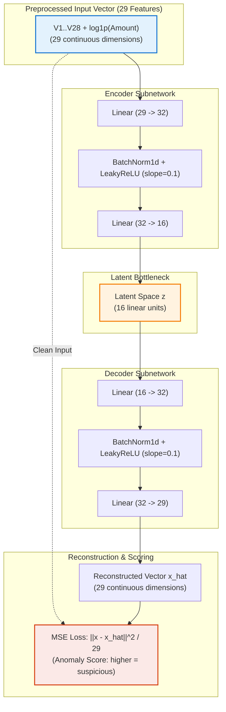

# Autoencoder Theory, Architecture & Anomaly‑Score Rationale

**Issue #39** – *Document autoencoder theory, architecture and anomaly‑score rationale*  
**Owner:** Rudra Pratap Singh Choudhary  
**Status:** Updated & Aligned with Merged Phase 2 Implementation (Issues #32, #34, #35, #36, #43)

---

## 1. Overview
This methods note explains **why** a reconstruction‑based autoencoder is used for credit‑card fraud triage, **how** the specific undercomplete denoising autoencoder implementation in the repository works, and **how** the reconstruction error is transformed into an anomaly score. It synthesizes literature from anomaly detection and representation learning while staying faithful to the merged implementation in `src/models/autoencoder.py` and the frozen checkpoint in `results/ae_frozen_model_manifest.json`.

---

## 2. Theory of Autoencoders for Anomaly Detection

| Concept | Description |
|---|---|
| **Autoencoder** | A neural network parameterized by encoder $f_\theta$ and decoder $g_\phi$ that learns to map an input vector $\mathbf{x} \in \mathbb{R}^{29}$ to a lower-dimensional latent representation $\mathbf{z} \in \mathbb{R}^{16}$ and reconstruct it as $\hat{\mathbf{x}} = g_\phi(\mathbf{z}) \in \mathbb{R}^{29}$. |
| **Undercomplete Bottleneck** | The latent bottleneck dimension ($d_{\text{latent}} = 16$) is strictly smaller than the input dimension ($D = 29$). This bottleneck constrains information capacity, compelling the network to capture the primary manifold regularities of legitimate spending behavior while discarding uncorrelated noise. |
| **Denoising Regularization** | Following Vincent et al. (2008), corrupted inputs $\widetilde{\mathbf{x}} = \mathbf{x} + \boldsymbol{\epsilon}$ (where $\boldsymbol{\epsilon} \sim \mathcal{N}(\mathbf{0}, 0.5^2 \mathbf{I})$ in scaled feature space) are passed during training while forcing reconstruction of the clean input $\mathbf{x}$. This teaches the network contractive projections toward the legitimate manifold. Denoising noise is applied strictly during training on legitimate data; inference consumes clean inputs. |
| **Reconstruction-Error Anomaly Scoring** | Because the model is trained exclusively on legitimate transactions (`train_legit`, $N = 198,242$, zero frauds), it learns the manifold of legitimate behavior. Fraudulent transactions departing from this manifold incur elevated reconstruction error $\|\mathbf{x} - \hat{\mathbf{x}}\|_2^2 / 29$, serving as an anomaly score for operational triage ranking. |

### Key Theoretical References
1. **Sakurada, M., & Yairi, T. (2014)** – *Anomaly Detection Using Autoencoders with Nonlinear Dimensionality Reduction*. Proc. MLSDA, pp. 4–11.
2. **Vincent, P., Larochelle, H., Bengio, Y., & Manzagol, P.-A. (2008)** – *Extracting and Composing Robust Features with Denoising Autoencoders*. Proc. ICML, pp. 1096–1103.
3. **Hawkins, S., He, H., Williams, C., & Baxter, R. (2002)** – *Outlier Detection Using Replicated Neural Networks*. Proc. ICANN, pp. 1260–1265.
4. **Dempster, A. P., Laird, N. M., & Rubin, D. B. (1977)** – *Maximum Likelihood from Incomplete Data via the EM Algorithm*. J. Royal Stat. Soc., Series B, 39(1):1–38.

---

## 3. Implemented Architecture (`src/models/autoencoder.py`)

The production network is implemented in `src/models/autoencoder.py` as `PyTorchAutoencoderNet`, adhering to Addendum A1 of `docs/ae_experiment_plan.md` and frozen checkpoint `RUN-S2-W16-DNZ-S7`.

```python
class PyTorchAutoencoderNet(nn.Module):
    """Symmetric feedforward autoencoder architecture."""

    def __init__(
        self,
        input_dim: int = 29,
        latent_dim: int = 16,
        hidden_dims: tuple[int, ...] = (32,),
    ) -> None:
        super().__init__()
        # Encoder: 29 -> 32 -> 16
        encoder_layers: list[nn.Module] = []
        current_dim = input_dim
        for h_dim in hidden_dims:
            encoder_layers.append(nn.Linear(current_dim, h_dim))
            encoder_layers.append(nn.BatchNorm1d(h_dim))
            encoder_layers.append(nn.LeakyReLU(negative_slope=0.1))
            current_dim = h_dim
        encoder_layers.append(nn.Linear(current_dim, latent_dim))
        self.encoder = nn.Sequential(*encoder_layers)

        # Decoder: 16 -> 32 -> 29
        decoder_layers: list[nn.Module] = []
        current_dim = latent_dim
        for h_dim in reversed(hidden_dims):
            decoder_layers.append(nn.Linear(current_dim, h_dim))
            decoder_layers.append(nn.BatchNorm1d(h_dim))
            decoder_layers.append(nn.LeakyReLU(negative_slope=0.1))
            current_dim = h_dim
        decoder_layers.append(nn.Linear(current_dim, input_dim))
        self.decoder = nn.Sequential(*decoder_layers)

    def forward(self, x: torch.Tensor) -> torch.Tensor:
        latent = self.encoder(x)
        return self.decoder(latent)
```

### Architectural Specifications
| Layer Stage | Input Dimension | Output Dimension | Activation / Normalization | Function |
|---|:---:|:---:|---|---|
| **Input** | – | 29 | – | Continuous features ($V_1,\dots,V_{28}, \log_{1p}(\text{Amount})$) |
| **Encoder Hidden** | 29 | 32 | `BatchNorm1d` + `LeakyReLU(negative_slope=0.1)` | Non-linear feature contraction |
| **Bottleneck Latent** | 32 | 16 | Linear (unconstrained coordinates) | Salient manifold representation |
| **Decoder Hidden** | 16 | 32 | `BatchNorm1d` + `LeakyReLU(negative_slope=0.1)` | Symmetric latent expansion |
| **Output Reconstruction** | 32 | 29 | Linear (identity mapping) | Reconstructed feature vector $\hat{\mathbf{x}}$ |

- **Loss Objective:** Mean Squared Error (MSE) across the 29 features:
  $$\mathcal{L}_{\text{MSE}}(\mathbf{x}, \hat{\mathbf{x}}) = \frac{1}{29} \sum_{j=1}^{29} (x_j - \hat{x}_j)^2$$
- **Training Noise:** Additive Gaussian noise $\sigma = 0.5$ on inputs, targets uncorrupted.
- **Optimization:** Adam optimizer, $\text{LR} = 1\times 10^{-3}$, batch size 256, weight decay 0.0, early stopping patience 10 on legitimate validation loss.
- **Training Population:** Strictly legitimate transactions (`train_legit`, $N = 198,242$). Fraud records are excised during training.

---

## 4. Scoring & Checkpoint‑Safe Inference Interface

### 4.1 Scoring Function
Anomaly scoring is implemented in `AutoencoderAnomalyModel.score`:
```python
def score(self, X: np.ndarray) -> np.ndarray:
    """Compute per-sample reconstruction Mean Squared Error (MSE)."""
    self.network.eval()
    with torch.no_grad():
        X_tensor = torch.from_numpy(X.astype(np.float32)).to(self.device)
        recon = self.network(X_tensor)
        errors = torch.mean((X_tensor - recon) ** 2, dim=1).cpu().numpy()
    return errors.astype(np.float64)
```

- **Score Direction:** `higher_is_more_suspicious`. Transactions with high reconstruction error are prioritized in the triage queue.
- **Determinism:** Evaluated with gradients disabled (`torch.no_grad()`) in evaluation mode (`eval()`). Re-scoring yields bit-identical outputs ($\max |\Delta| = 0.0$).

### 4.2 Score Export Contract
Exported score files comply with `docs/score_file_schema.md`:
- Columns: `row_id,split,model,anomaly_score`
- Model identifier: `autoencoder`
- Row ID: Immutable raw 0-based dataset row index.

### 4.3 Checkpoint Governance
The production checkpoint is frozen at `results/phase2/checkpoints/RUN-S2-W16-DNZ-S7.pt` (SHA-256 `0d247ab9757cd3b15caeaba0049dd7825c8049998dd57a649307c87c64b4a1fb`) per `results/ae_frozen_model_manifest.json`.

---

## 5. Architectural Flow Diagram



---

## 6. Known Limitations & Failure Modes
1. **Reconstruction False Negatives on Subtle Frauds:** Sophisticated frauds mimicking normal transaction amounts and behavioral PCA coordinates reconstruct with low error, resulting in false negatives.
2. **Uncalibrated Metric:** Reconstruction MSE is a geometric distance metric in feature space, not a calibrated posterior fraud probability $P(\text{Class}=1 \mid \mathbf{x})$.
3. **No Direct Account/Temporal Context:** Time is excluded from input features to prevent time-decay artifacts, which limits detection of rapid transaction bursts across short intervals.
4. **Single-Scalar Compression:** Using average MSE compresses 29 dimensional residuals into a single scalar; localized anomalies on single features may be diluted.

---

## 7. Handover and Report Traceability
This methods document serves as the foundational technical description for:
- **Technical Report (Section IV-B):** `reports/phase2/main.tex` and `reports/phase2/main.pdf`
- **Model Card (Sections 1–4):** `docs/model_card.md`
- **Paired Evaluation:** `docs/paired_evaluation.md` and `results/phase2/paired/`
